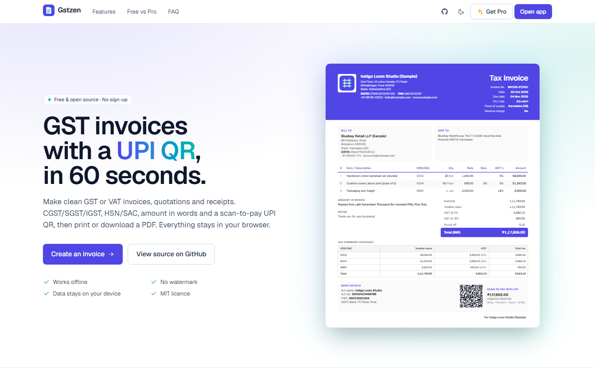
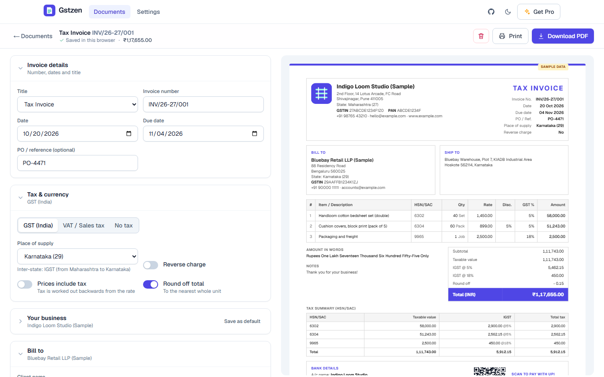
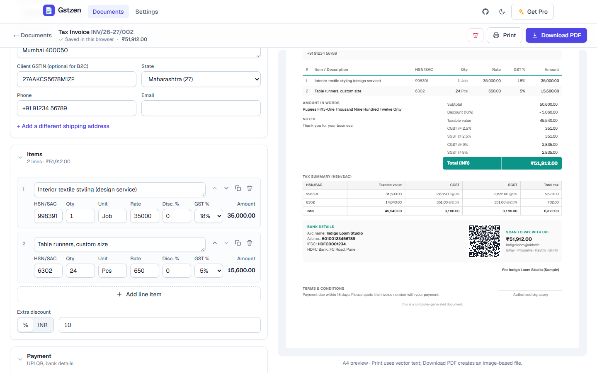
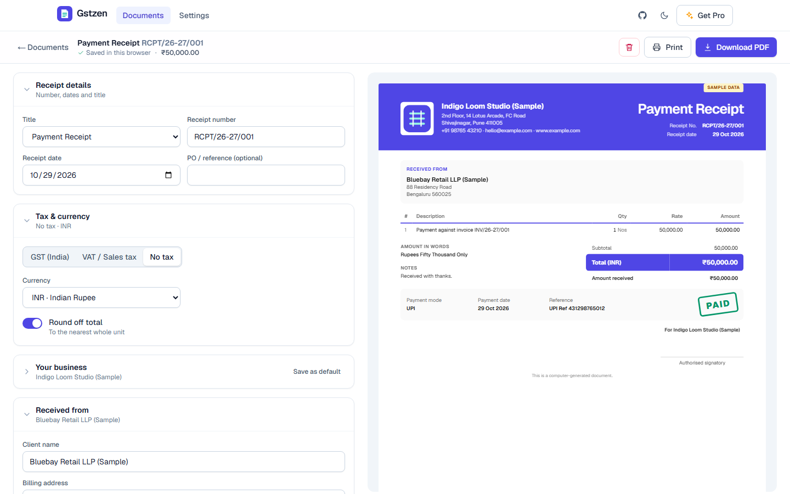

# EpiFive GST Invoice: free GST invoice generator with UPI QR

**Make a clean GST or VAT invoice in 60 seconds. It includes a UPI QR so clients pay instantly, and exports to PDF.**

EpiFive GST Invoice is an open-source invoice, quotation and receipt maker that runs entirely in your browser. It handles Indian GST properly (GSTIN check, place of supply, CGST + SGST or IGST, HSN/SAC tax summary, amount in words in lakh/crore) and also works for VAT, sales tax or no-tax invoices in 20+ currencies. No sign-up, no server, no trackers.

**Live demo:** https://gst-invoice-demo.pages.dev (loads sample data on first visit; clear it from the yellow banner)



| Editor with live A4 preview | Documents |
|---|---|
|  |  |
|  |  |

## Features

- **Invoices, quotations and receipts**: Tax Invoice, Bill of Supply, Proforma, Export Invoice, Quotation, Estimate, Payment Receipt (with a PAID / PART PAID stamp) or your own title.
- **GST done right**: GSTIN validation with checksum (state and PAN fill in automatically), place of supply for every state and UT, CGST + SGST/UTGST for intra-state, IGST for inter-state and exports, reverse-charge flag, HSN/SAC per line and an HSN-wise tax summary.
- **GST rates**: 0, 0.25, 3, 5, 18 and 40% presets plus any custom rate. Prices can be tax-exclusive or tax-inclusive.
- **Discounts and round-off**: per-line discount %, an extra discount (percent or flat) spread across lines before tax, and round-off to the nearest rupee.
- **Amount in words**: Indian numbering for ₹ ("Rupees One Lakh Twenty-Three Thousand… and Fifty Paise Only") and international words for other currencies.
- **UPI QR**: a `upi://pay` QR with your UPI ID, name, the amount due and the invoice number, generated locally. Clients scan with GPay, PhonePe, Paytm or BHIM.
- **Bank details, logo and signature** on every document; notes and terms.
- **Numbering**: per-type formats with `{FY}`, `{FYS}`, `{YYYY}`, `{YY}`, `{MM}` and `{N}` tokens (e.g. `INV/26-27/001`), duplicate check and the 16-character GST rule.
- **PDF and print (A4)**: print with crisp vector text (Save as PDF), or download a PDF file directly. Long invoices break across pages at row boundaries.
- **VAT / sales tax / no-tax mode** in 20+ currencies (USD, EUR, GBP, AED, SAR, AUD, CAD, SGD, ZAR, JPY…).
- **3 templates** (Classic, Modern, Minimal) and 6 accent colours.
- **Private**: everything is saved in your browser's localStorage. JSON backup and restore (merge or replace) and a documents CSV are always available.
- **Light and dark mode**, responsive editor with an Edit/Preview switch on phones.

> [!IMPORTANT]
> **Not GST e-invoicing (IRN).** EpiFive GST Invoice makes regular GST tax invoices, quotations and receipts. It does not register invoices on the Invoice Registration Portal (IRP) and does not generate an IRN or the signed e-invoice QR code. Businesses that must issue e-invoices (aggregate turnover above the notified threshold, currently ₹5 crore) have to report B2B invoices on the IRP. You are responsible for tax rates, HSN/SAC codes and place of supply; check with your tax adviser. This is not legal or tax advice.

## Free vs Pro

| | Free (this repo) | Pro |
|---|:---:|:---:|
| GST invoices, quotations and receipts | ✅ | ✅ |
| CGST/SGST vs IGST, HSN/SAC tax summary | ✅ | ✅ |
| UPI QR, bank details, logo, signature | ✅ | ✅ |
| VAT / no-tax mode, 20+ currencies | ✅ | ✅ |
| Print and PDF, unlimited documents, no watermark | ✅ | ✅ |
| JSON backup/restore and documents CSV | ✅ | ✅ |
| Templates | 3, 6 colours | 13, any colour |
| Business profiles / branches | 1 | Unlimited, own numbering each |
| Client and product library with autofill | | ✅ |
| Duplicate, convert quote → invoice, recurring invoices | | ✅ |
| Payment status, partial payments, overdue list | | ✅ |
| Reports and GSTR-1 style export (B2B, B2CL, B2CS, HSN) | | ✅ |
| Excel (.xlsx) and line-item CSV export | | ✅ |
| WhatsApp / email share and payment reminders | | ✅ |
| Payment link (Razorpay, Stripe, PayPal) on the invoice | | ✅ |
| White-label (your name, logo, domain; no EpiFive branding) | | ✅ |
| Licence | MIT | Commercial, 1 year of updates + support |

**Get Pro (₹1,999 / $29, one-time): https://www.epifive.com/products/gst-invoice-pro**

## Quick start

Requirements: Node.js 20.9 or newer.

```bash
git clone https://github.com/epifive/gst-invoice.git
cd gst-invoice
npm install
npm run dev        # http://localhost:3000
```

Other scripts:

```bash
npm test           # unit tests (GST maths, GSTIN, words, UPI, numbering, storage)
npm run lint
npm run build      # static site in out/
```

### Configuration (optional)

| Variable | Default | What it does |
|---|---|---|
| `NEXT_PUBLIC_SITE_URL` | `https://gst-invoice-demo.pages.dev` | Canonical URL used for SEO tags, sitemap and the OG image |
| `NEXT_PUBLIC_DEMO_SEED` | unset | Set to `1` to load sample data on a visitor's first visit (used by the live demo) |

## Deploy

`npm run build` produces a fully static site in `out/`. Host it anywhere:

- **Cloudflare Pages**: build command `npm run build`, output directory `out`. Or from your machine:
  `npx wrangler pages deploy out --project-name <your-project>`.
- **Vercel / Netlify**: import the repo; the framework preset works as is (output directory `out`).
- **GitHub Pages, S3, Nginx, Apache or any web server**: upload the contents of `out/`.

There is no backend and no database. Each user's data stays in their own browser.

## How the tax maths works

- Line amount = qty × rate − line discount %.
- The extra discount is spread across lines in proportion to their amount, so it reduces each line's taxable value.
- With tax-inclusive prices, taxable value = amount ÷ (1 + rate).
- GST: if your state equals the place of supply, tax is split 50/50 into CGST and SGST (UTGST for Chandigarh, Ladakh, Lakshadweep, Andaman & Nicobar and DNH & DD); otherwise IGST. Each component is rounded per rate.
- Round-off makes the grand total a whole number and shows the difference.

The logic lives in `src/lib/calc.ts` and is covered by tests in `tests/`.

## Project structure

```
src/app/            Landing page, /app (documents), /app/edit, /app/settings
src/components/     DocView (the A4 document), Editor, ItemsEditor, templates
src/lib/            calc, gst, words, money, upi, qr, numbering, storage, store, pdf, csv
tests/              Vitest unit tests
```

## Contributing

Issues and pull requests are welcome. Please run `npm test`, `npm run lint` and `npm run build` before opening a PR. Keep the free edition free of paid APIs and trackers.

## Licence

MIT © 2026 EpiFive. See [LICENSE](LICENSE).

---

- Get Pro: https://www.epifive.com/products/gst-invoice-pro
- More open-source projects: https://www.epifive.com/open-source
- Need a custom app built? https://www.epifive.com/services#custom-app-development
